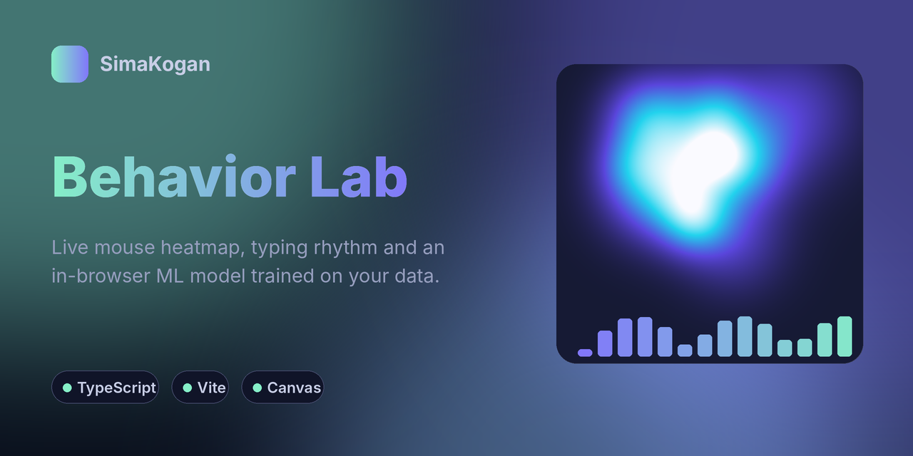
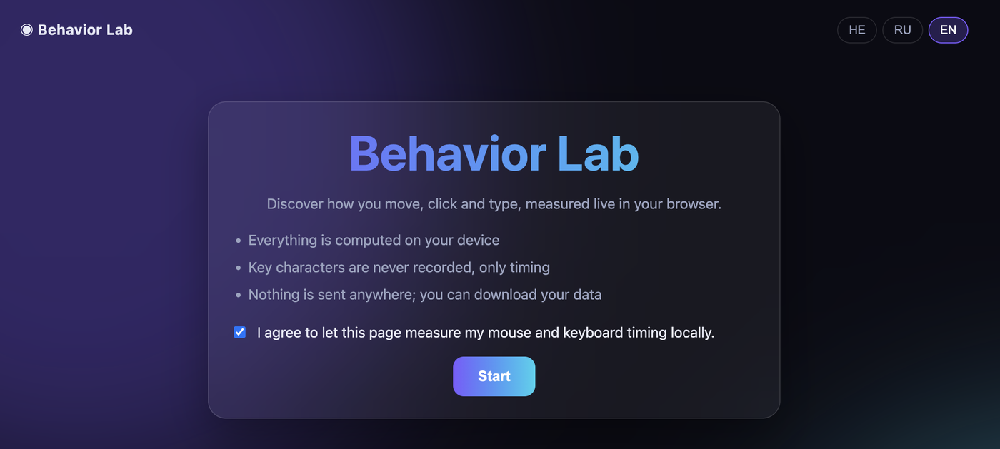
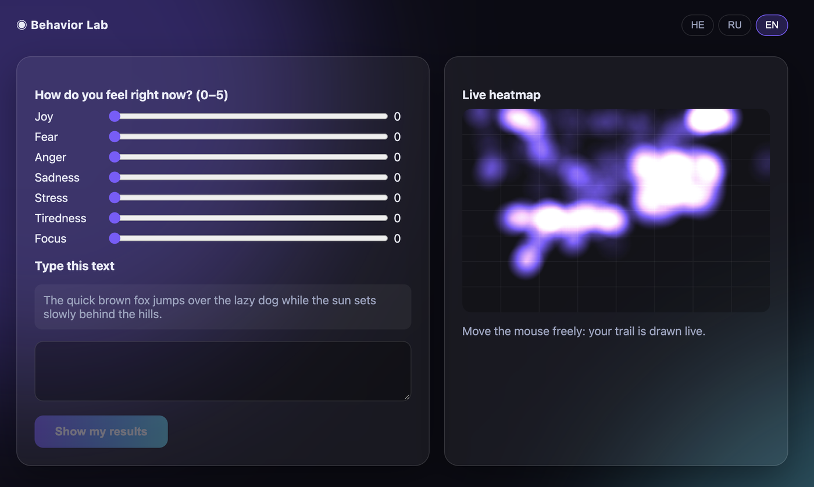

<div align="center">



# ◉ Behavior Lab

**A privacy-first browser lab that measures how you move, click and type, and shows it as live charts.**

[**▶ Live demo**](https://simakogan.github.io/behavior-lab/) · [Report a bug](https://github.com/SimaKogan/behavior-lab/issues)


</div>

## Screenshots

<table>
  <tr>
    <td width="50%"><br/><sub><b>Start:</b> clear privacy promises and explicit consent</sub></td>
    <td width="50%"><br/><sub><b>Test:</b> mood sliders, typing task and a live mouse heatmap</sub></td>
  </tr>
</table>

## Features
- 🔥 Live mouse **heatmap** (canvas, additive glow)
- ⌨️ **Typing rhythm** histogram (intervals between keystrokes)
- 🖱 Cursor speed, Backspace share, click count
- 🕸 **Radar chart** of self-reported mood: joy, fear, anger, sadness, stress, tiredness, focus
- 🧠 **Personal in-browser model** trained on your own saved sessions (see below)
- 🌍 Trilingual UI: עברית / Русский / English, with RTL support
- 🌙 Dark glassmorphism design with smooth animations

## Personal model (in-browser ML)
After each session you can save your features (cursor speed, key intervals, Backspace share, clicks per minute, keys per second) together with your self-reported mood to `localStorage`. From 5 sessions on, a small **ridge regression**, implemented from scratch in [`src/model.ts`](src/model.ts) with no libraries, is trained on *your own* data and predicts your mood from your behavior.

Honesty is built in: accuracy is measured with **leave-one-out cross-validation** and compared with the baseline "always guess your average", so you can see whether the model actually learned something.

## Privacy
- 100% client-side: no backend, no analytics, no network requests.
- Key **characters are never stored**, only timestamps and whether a key was Backspace.
- Data leaves the page only if you press **Download JSON**; saved sessions can be deleted at any time.
- Results are raw measurements, not an emotion prediction or a diagnosis.

## Run locally
```bash
npm install
npm run dev      # http://localhost:5173
npm run build    # output in dist/
```

## Project structure
```
src/
  main.ts      UI, steps (intro → test → results), event wiring
  tracker.ts   mouse / keyboard timing capture and statistics
  charts.ts    canvas charts: heatmap, rhythm histogram, radar
  model.ts     ridge regression + leave-one-out evaluation
  i18n.ts      HE / RU / EN strings
```

## Deploy
Push to `main`; the included GitHub Actions workflow builds the app and publishes it to GitHub Pages (Settings → Pages → Source: **GitHub Actions**).

## Stack
Vite + TypeScript, no runtime dependencies.

## Author
**Sima Kogan** · [GitHub](https://github.com/SimaKogan) · [Portfolio](https://simakogan.github.io/portfolio/)
